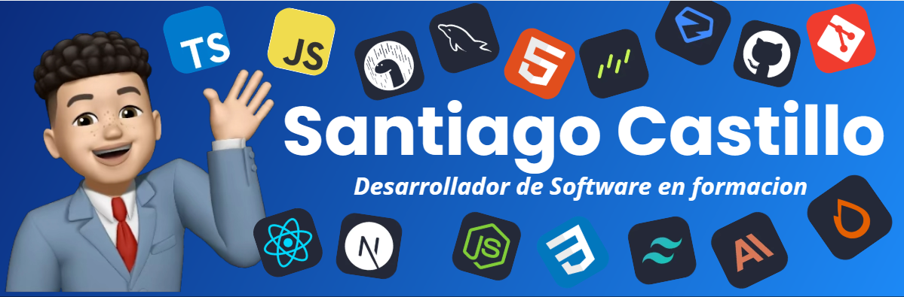
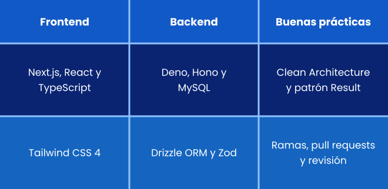
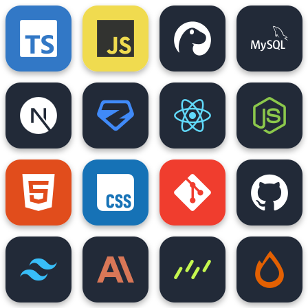

 <!-- Encabezado -->

  

<!-- Sobre mí -->
<table>
  <tr>
    <td width="50%" valign="top">
      

        
      

      

        <i>Aprendiz del SENA en el tecnólogo en <b>Análisis y Desarrollo de Software (ADSO)</b>.</i>
      

      

        Construyo aplicaciones web completas, desde la interfaz hasta la API y la base de datos,
        con arquitectura limpia, validación con contratos compartidos y pruebas contra la API real.
      

    </td>
    <td width="50%" valign="middle">
      
    </td>
  </tr>
</table>

<!-- Stack + Estadísticas -->
<table>
  <tr>
    <td width="40%" valign="top" align="center">
      
        
      
    </td>
    <td width="60%" valign="top" align="center">
      
        
      
      
      
    </td>
  </tr>
</table>

<!-- Proyecto destacado -->
<table>
  <tr>
    <td width="66%" valign="top">
      

        
      

      

        <a href="https://github.com/castillograndasantiagoeduardo-design/inventa"><b>Inventa</b></a>
        — Plataforma de gestión de inventario, facturación y personal con un asistente de IA integrado
        mediante Model Context Protocol (MCP). Backend en Deno + TypeScript + MySQL Workbench
        (Clean Architecture), frontend en React + Next.js.
      

      

        <b>Mi aporte</b> 
        Panel Super Admin completo con dashboard, usuarios, roles y auditoría 
        Punto de venta para cajeros y módulo B2B 
        Componentes reutilizables y endpoints del backend
      

    </td>
    <td width="34%" valign="bottom" align="right">
      
    </td>
  </tr>
</table>

<!-- Automatizaciones & MCPs -->
<table>
  <tr>
    <td colspan="2" align="center">
      
      

        Desarrollo servidores <b>Model Context Protocol (MCP)</b> y flujos automatizados para conectar
        modelos de IA con bases de datos, APIs y herramientas de productividad.
      

    </td>
  </tr>
  <tr>
    <td width="50%" valign="top">
          

        <b><a href="https://github.com/castillograndasantiagoeduardo-design/mcp-scaffolding">mcp-scaffolding</a></b> 
        Servidor MCP desarrollado con Deno que automatiza la generación de proyectos en Python y TypeScript bajo Arquitectura Limpia y Hexagonal. Expone herramientas para inicializar monorepos modulares (apps, packages, services) con desacoplamiento estricto por capas (domain, application, infrastructure, ports y adapters). 
        <code>TypeScript</code> · <code>MCP SDK</code> · <code>Deno</code> · <code>Clean Architecture</code>
      

     </td>
     <td width="50%" valign="top">
         

        <b><a href="https://github.com/castillograndasantiagoeduardo-design/mcp-database-server">mcp-database-server</a></b> 
        Servidor MCP universal para bases de datos relacionales (PostgreSQL, MySQL, SQLite y SQL Server). Expone herramientas de introspección de esquemas y mapeo de llaves foráneas para JOINs, consultas SELECT de solo lectura, y un flujo transaccional seguro con doble confirmación humana mediante tokens temporales para operaciones INSERT, UPDATE y DELETE. 
        <code>Python</code> · <code>FastMCP</code> · <code>SQLAlchemy</code> · <code>Pydantic</code>
      

    </td>
  </tr>
  <!-- Copia y pega un nuevo <tr>...</tr> aquí si quieres agregar más MCPs -->
</table>

<!-- Otros Proyectos -->
<table>
  <tr>
    <td colspan="2" align="center">
      
    </td>
  </tr>
  <tr>
    <td width="50%" valign="top">
      

        <b><a href="#">Nombre del Proyecto #1</a></b> 
        Descripción corta del problema que resuelve y su arquitectura principal. 
        <code>Next.js</code> · <code>TypeScript</code> · <code>MySQL</code>
      

    </td>
    <td width="50%" valign="top">
      

        <b><a href="#">Nombre del Proyecto #2</a></b> 
        Descripción corta del problema que resuelve y su arquitectura principal. 
        <code>Hono</code> · <code>Drizzle ORM</code> · <code>Tailwind CSS</code>
      

    </td>
  </tr>
  <!-- Copia y pega un nuevo <tr>...</tr> aquí para agregar otra fila de 2 proyectos -->
</table>

<!-- Conecta conmigo -->

  

  

  
  
  
  

